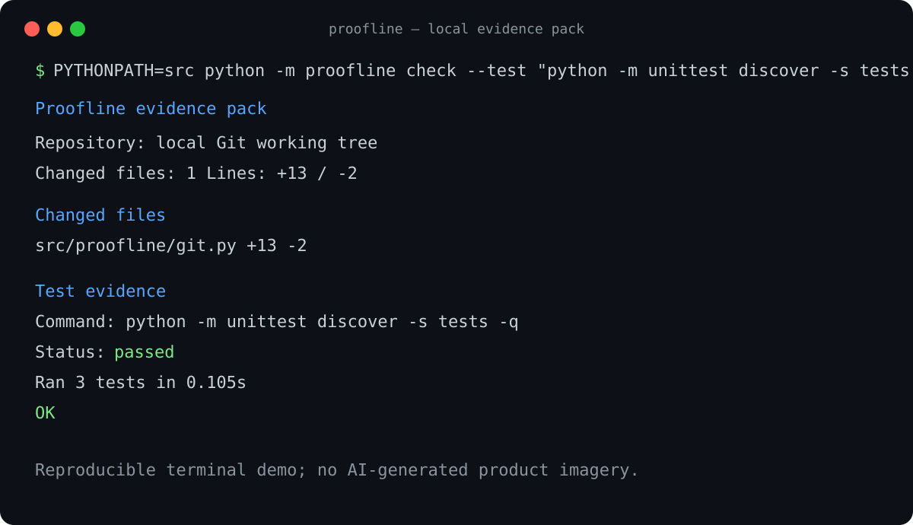

# Proofline

Proofline creates a local evidence pack for reviewing a Git change: changed paths, deterministic review cues, and optional evidence from a test command you explicitly choose.

It is useful when AI-assisted code makes implementation fast but leaves a reviewer needing a compact, reproducible answer to: *what changed, what deserves attention, and what was actually tested?*

No API key, model, or cloud service is used.

## Demo



This is a faithful, reproducible rendering of the safe fixture run recorded in [`reports/smoke/proofline-report.md`](reports/smoke/proofline-report.md). It shows the generated change summary and a passing explicit test command; it is not AI-generated product imagery.

## Quick start

Requirements: Python 3.10+ and Git.

```sh
PYTHONPATH=src python -m proofline check --test "python -m unittest discover -s tests -v" --output-dir evidence
```

This writes `evidence/proofline-report.md` and `evidence/proofline-report.json`. Omit `--test` to guarantee Proofline runs no test command.

```sh
PYTHONPATH=src python -m proofline check --staged --output-dir evidence
```

## What it captures

- working-tree or staged Git changes and line counts;
- review cues for auth, configuration, CI, dependency, migration, generated/minified, and test paths;
- output, status, and timeout result for an explicitly supplied test command; and
- a Markdown/JSON checklist for a human reviewer.

## Safety and limitations

The test command is executed with your shell exactly because you supplied it; inspect it before running. Captured output receives best-effort redaction for common token/password/API-key assignments and bearer values. Inspect artifacts before sharing them.

Proofline does not prove correctness, replace review, scan for vulnerabilities, or make security findings. Its cues are prompts for human inspection.

## Development

```sh
PYTHONPATH=src python -m unittest discover -s tests -v
```
